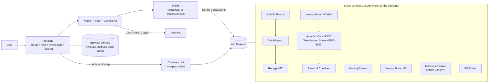
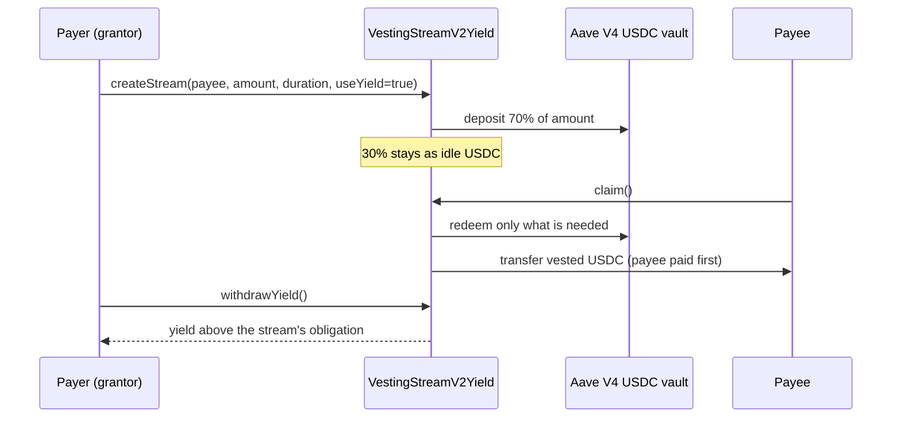

# RacconPay

Non-custodial USDC and EURC money tools on Arc. Pay many people at once, stream salary with leave controls, lock funds in milestone escrow, send invoices, split bills, swap, and optionally earn yield on locked funds through Aave V4.

Built with [Arc Studio](https://studio.arc.io) for the ETHGlobal Continuity Track. Runs on Arc Mainnet (chain ID 5042). USDC is the gas token, so fees are predictable and finality is under a second.

> Status: the contracts have unit, fuzz and fork tests but have not had an independent audit. Use small amounts.

## The problem

Teams, freelancers and finance departments that pay people in stablecoins use a patchwork of tools: one for batch payments, one for salary streaming, one for invoices, one for escrow. Vesting tools lack HR controls such as leave, pauses, approvals and reports. Locked money earns nothing, and on most chains gas is a separate token with a changing price.

RacconPay puts these tools in one non-custodial app on Arc.

## What it does

| Feature | Page | What it does |
|---|---|---|
| Batch Payout and Receipts | `/pay` | Send USDC to up to 100 recipients in one transaction (larger lists are split into chunks). Checks the USDC blocklist first. Mints a soul-bound receipt NFT to the payer. |
| Vesting console | `/vesting` | Streams that release USDC linearly. Pay and Receive views, leave and pauses with approvals, bulk CSV upload, address book, activity report (CSV). |
| Optional yield | `/vesting` | When creating a stream, 70% can be deposited into the Aave V4 USDC vault on Arc and 30% stays in the contract so claims are always paid. The payee is paid first. |
| Milestone Escrow | `/escrow` | Lock USDC or EURC for a payee, release per milestone, optional arbiter, disputes and refunds. |
| Swap | `/swap` | USDC, EURC and cirBTC swaps through Circle App Kit, with quote review and minimum received shown first. |
| Invoices | `/invoice` | Create USDC or EURC payment requests with a pay link, QR code and PDF export. Paid status is read from the chain. |
| Bill Splitter | `/split` | Track shared expenses and settle in USDC. |
| MultiSig Payout | `/multisig` | Payouts that need co-signer approval. |
| Dashboard | `/dashboard` | Balances, streams, receipts, invoices and escrows in one place. |

## Architecture

RacconPay has no traditional application server. The frontend talks directly to Arc through the user's wallet, and the **smart contracts are the backend**: they hold the funds, enforce the rules and store the state. Swaps use Circle's hosted App Kit service.



### Yield flow



### How the pieces fit

- **Frontend:** React 18, Vite, TypeScript, Tailwind CSS, React Router. State and chain access go through wagmi v2 and viem v2. ConnectKit provides the wallet modal.
- **Wallets:** injected wallets (for example MetaMask) and optional WalletConnect (set `VITE_WALLETCONNECT_PROJECT_ID`).
- **Contracts:** Solidity 0.8.28 with OpenZeppelin 5.1, built and tested with Foundry. Source in `contracts/`, tests in `contracts/test/`.
- **Config in one place:** chain setup in `src/config.ts`, deployed addresses and explorer helpers in `src/constants.ts`, token registry (USDC, EURC, cirBTC) in `src/tokens.ts`.
- **Swap:** `src/components/SwapPage.tsx` uses Circle App Kit and its viem adapter. Arc supports only USDC, EURC and cirBTC for swaps.
- **No custody:** the app never holds keys or funds. Invoices and address-book labels are kept in the browser.

## Deployed contracts (Arc Mainnet, chain 5042)

| Contract | Address |
|---|---|
| VestingStreamV2 | `0x09c6Dc5A8f169e614771920a47B9B4d5e1063900` |
| VestingStreamV2Yield | `0x4bb6D83bFDa8bECc397986EADe909294bB3b31BD` |
| MilestoneEscrow (USDC + EURC) | `0xcD971ac0cC0664C8e6Db791468eC42C59816b624` |
| BatchPayout v3 | `0x1Da442B6cd376cBaDA9F86E5F88643ea6Ac8bBC9` |
| ReceiptNFT v2 | `0x97BBF37EAd1f3Dd3AF0a2c397085bF35cacf71D1` |
| VestingStream v1 | `0x712c4C15c2d395c4EAa3377751afACfb14eFff03` |
| BillSplitter v3 | `0x1362beC447F1350Eb4b072F2De92FBD29Abb72d3` |
| MultiSigPayout v4 | `0xF5ae83341dfd707f55F8f3818f9B6EACceC3f45e` |

Tokens and protocols used: USDC `0x3600000000000000000000000000000000000000` (6 decimals as ERC-20), EURC `0xbEf5f6d51CB62b58e6A8f77868681825C6fe21c1`, cirBTC `0x171A4217b86A807A64eB94757Db6849fb4bDbAA0` (8 decimals), Aave V4 Core USDC Tokenization Spoke `0x42EAB64310E1D1c66b4d8aF7C9C4ce253885eB83`.

Explorer: https://explorer.arc.io

## Run it locally

```
bun install
bun run dev
```

Optional `.env` values:
- `VITE_WALLETCONNECT_PROJECT_ID`: enables WalletConnect.
- `VITE_VESTING_V2_ADDRESS_MAINNET`, `VITE_VESTING_YIELD_ADDRESS_MAINNET`: override the deployed vesting contracts.

Checks:

```
bun run typecheck
bun run lint
bun run build
```

## Contracts: build and test

```
forge build
forge test
```

Yield fork test against the real Aave V4 vault on a local copy of Arc Mainnet (needs Arc Foundry, which can simulate Arc's native USDC; nothing is sent to mainnet):

```
RUN_AAVE_FORK=1 arc-forge test --network arc --match-path "contracts/test/VestingStreamV2Yield.AaveFork.t.sol" -vv
```

Latest results: 705 of 708 tests pass in the full suite. The 3 failures are in `MilestoneEscrowV2`, a variant the app does not use. The 7 yield fork tests pass.

## Deploying to mainnet

Done by you, from your own computer, with an encrypted keystore. The private key never goes in a file. See `docs/mainnet-deploy-guide.md`.

## Continuity Track: what existed and what is new

Existing before the hackathon: Batch Payout and Receipts, Vesting v1, Bill Splitter, MultiSig and Invoices on Arc Mainnet.

Added with Arc Studio: the vesting console (leave and pauses, bulk CSV, address book, reports), opt-in yield through Aave V4, Milestone Escrow, Swap through Circle App Kit, and the mainnet deployments of the new contracts.

Prize-card fit: USDC and EURC payment flows added to an existing fintech product, and escrow plus Aave-based yield logic. Crosschain and nanopayments are not built.

## AI tools

Arc Studio (Circle's AI assistant) was used to plan, review and edit the code, research the Aave V4 vault, write the fork test, and draft documentation. Contracts were deployed by the author, not by the AI tool.

## Known limitations

- No independent audit. Start with small amounts.
- Yield depends on Aave V4 liquidity: claims can wait if the vault cannot pay out.
- Invoices and labels are stored in the browser, so they do not sync across devices.
- Single chain (Arc). Swaps are limited to USDC, EURC and cirBTC.

## Next steps

Independent audit, crosschain funding with Circle's bridge and unified balance, a small backend for synced invoices and notifications, and more payout currencies.
