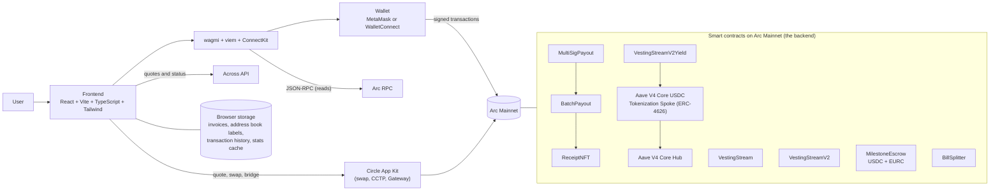
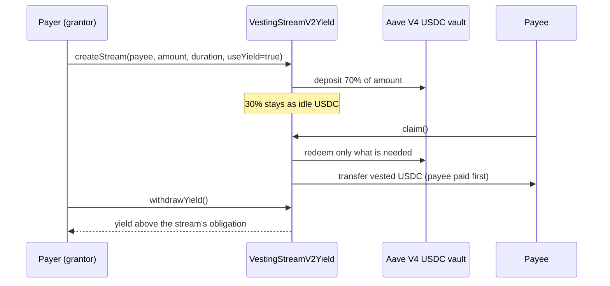

# RacconPay

Non-custodial USDC and EURC money tools on Arc, in two sections. **Business:** pay many people at once with optional co-signer approval, stream salary with leave controls, lock funds in milestone escrow and send invoices. **Personal:** split bills, swap USDC, EURC and cirBTC, and bridge to and from Arc. Locked vesting funds can optionally earn yield through Aave V4.

## The problem

Teams, freelancers and finance departments that pay people in stablecoins use a patchwork of tools: one for batch payments, one for salary streaming, one for invoices, one for escrow. Vesting tools lack HR controls such as leave, pauses, approvals and reports. Locked money earns nothing, and on most chains gas is a separate token with a changing price.

RacconPay puts these tools in one non-custodial app on Arc.

## What it does

The app has a sidebar with three groups: **Business**, **Personal** and **Global**.

**Business**

| Feature | Page | What it does |
|---|---|---|
| Overview | `/dashboard` | USDC balance, total sent in batch payouts, pending vesting withdrawals, batch payout count, quick actions and a searchable activity table. Tabs for streams, receipts and invoices. |
| Payouts | `/pay` | Send USDC to many recipients (CSV upload or manual entry, up to 100 per transaction, larger lists are split). Checks the USDC blocklist first and mints a soul-bound receipt NFT. Choose **Send now** or **Require approval**. |
| Approvals | `/pay?tab=approvals` | With Require approval, a payout becomes a request that two named co-signers must both approve before the payer can execute it. Requests expire after seven days. Old `/multisig` links redirect here. |
| Vesting console | `/vesting` | Streams that release USDC linearly, with leave and pauses, bulk CSV upload, an address book, reports, and optional Aave V4 yield (70% deposited, 30% kept in the contract). |
| Milestone Escrow | `/escrow` | Lock USDC or EURC for a payee, release per milestone, optional arbiter, disputes and refunds. |
| Invoices | `/invoice` | USDC or EURC payment requests with a pay link, QR code and PDF export. Paid status is read from the chain. |

**Personal**

| Feature | Page | What it does |
|---|---|---|
| Personal Overview | `/personal` | USDC balance, your bill splits, and swaps and bridges made in this browser, with quick actions. |
| Bill Split | `/split` | Equal-split group expenses that settle in USDC, with a QR code or link to share. |
| Swap | `/swap` | USDC, EURC and cirBTC swaps through Circle App Kit. Shows the quote, rate, minimum received and any provider fees before you confirm. Slippage presets plus a custom value. |
| Bridge | `/bridge` | Move USDC (and EURC on supported EVM routes) between Arc and Ethereum, Base, Avalanche or Solana, in either direction. Choose CCTP, Gateway or Across. A transfer is marked complete only once the destination side is confirmed. |

**Global**

| Feature | Page | What it does |
|---|---|---|
| Transaction History | `/history` | Business and Personal tabs with type filters, network, amount, status and explorer links. Built from your on-chain receipts and the swaps, bridges and payments confirmed in this browser. |
| Settings | `/settings` | Theme (light or dark), network details and the connected wallet. |
| Docs | `/docs` | Guides for every feature. |

The home page shows live Arc Mainnet counts: transactions, users and volume paid into the contracts.

## Architecture

RacconPay has no traditional application server. The frontend talks directly to Arc through the user's wallet, and the **smart contracts are the backend**: they hold the funds, enforce the rules and store the state. Swaps and bridges use Circle's hosted App Kit service, and the Across option uses Across's public API.



### Yield flow



### How the pieces fit

- **Frontend:** React 18, Vite, TypeScript, Tailwind CSS, React Router. State and chain access go through wagmi v2 and viem v2. ConnectKit provides the wallet modal.
- **Wallets:** injected wallets (for example MetaMask) and optional WalletConnect (set `VITE_WALLETCONNECT_PROJECT_ID`).
- **Contracts:** Solidity 0.8.28 with OpenZeppelin 5.1, built and tested with Foundry. Source in `contracts/`, tests in `contracts/test/`.
- **Config in one place:** chain setup in `src/config.ts`, deployed addresses and explorer helpers in `src/constants.ts`, token registry (USDC, EURC, cirBTC) in `src/tokens.ts`.
- **Swap:** `src/components/SwapPage.tsx` uses Circle App Kit and its viem adapter. Arc supports only USDC, EURC and cirBTC for swaps.
- **Bridge:** `src/components/BridgePage.tsx` and `src/bridge/` use App Kit for CCTP and Gateway (EVM chains and Solana through Phantom) and Across's API for the Across option. Chains and token addresses are in `src/bridge/chains.ts`.
- **Payouts with approval:** the Payouts page creates a request on `MultiSigPayout` instead of paying directly. The approval step is a process check: the payer's wallet still pays when the request is executed. The number of co-signers is fixed at two.
- **Stats:** counts on the home page and Bill Split page are read from Arc's RPC and cached in the browser. `src/stats/snapshot.json` holds history up to a block so first visits only read newer blocks. Refresh it with `bun run stats:snapshot`.
- **Design system:** colours, type and shared components are in `src/index.css`, `tailwind.config.js`, `src/components/ui.tsx` and `src/components/kit/`. Light and dark themes share the same tokens.
- **No custody:** the app never holds keys or funds. Invoices, address-book labels and your confirmed transaction history are kept in the browser.

## Deployed contracts (Arc Mainnet, chain 5042)

| Contract | Address |
|---|---|
| VestingStreamV2 | `0x09c6Dc5A8f169e614771920a47B9B4d5e1063900` |
| VestingStreamV2Yield | `0x4bb6D83bFDa8bECc397986EADe909294bB3b31BD` |
| MilestoneEscrow (USDC + EURC) | `0xcD971ac0cC0664C8e6Db791468eC42C59816b624` |
| BatchPayout v3 | `0x1Da442B6cd376cBaDA9F86E5F88643ea6Ac8bBC9` |
| ReceiptNFT v2 | `0x97BBF37EAd1f3Dd3AF0a2c397085bF35cacf71D1` |
| VestingStream v1 | `0x712c4C15c2d395c4EAa3377751afACfb14eFff03` |
| BillSplitter v3 | `0x1362beC447F1350Eb4b072F2De92FBD29Abb72d3` |
| MultiSigPayout v4 | `0xF5ae83341dfd707f55F8f3818f9B6EACceC3f45e` |

Tokens and protocols used: USDC `0x3600000000000000000000000000000000000000` (6 decimals as ERC-20), EURC `0xbEf5f6d51CB62b58e6A8f77868681825C6fe21c1`, cirBTC `0x171A4217b86A807A64eB94757Db6849fb4bDbAA0` (8 decimals), Aave V4 Core USDC Tokenization Spoke `0x42EAB64310E1D1c66b4d8aF7C9C4ce253885eB83`.

Explorer: https://explorer.arc.io

## Run it locally

```
bun install
bun run dev
```

Optional `.env` values:
- `VITE_WALLETCONNECT_PROJECT_ID`: enables WalletConnect.
- `VITE_VESTING_V2_ADDRESS_MAINNET`, `VITE_VESTING_YIELD_ADDRESS_MAINNET`, `VITE_VESTING_YIELD_DEPLOY_TX_MAINNET`: override the deployed vesting contracts.
- `RPC_PROXY_BASE_URL`, `RPC_PROXY_CHAINS`, `RPC_PROXY_TOKEN`: only read by `bun run stats:snapshot`. When set, the script uses that RPC proxy for faster reads. Without them it uses the public Arc RPC, which is slow.

Checks:

```
bun run typecheck
bun run lint
bun run build
bun run stats:snapshot   # refresh src/stats/snapshot.json
```

## Contracts: build and test

```
forge build
forge test
```

Yield fork test against the real Aave V4 vault on a local copy of Arc Mainnet (needs Arc Foundry, which can simulate Arc's native USDC; nothing is sent to mainnet):

```
RUN_AAVE_FORK=1 arc-forge test --network arc --match-path "contracts/test/VestingStreamV2Yield.AaveFork.t.sol" -vv
```

Latest full-suite run: 709 tests, 704 passed, 4 failed, 1 skipped. The failures are one batch-payout fuzz test (`testFuzz_SingleRecipient`) and three in `MilestoneEscrowV2` (refund and change timing), a variant the app does not use. The 7 yield fork tests pass.


## Known limitations

- Yield depends on Aave V4 liquidity: claims can wait if the vault cannot pay out.
- Invoices, labels and transaction history are stored in the browser, so they do not sync across devices. Swaps and bridges made before this history existed, or in another browser, are not listed.
- Payout approvals use a fixed two co-signers. One approver, or three or more, needs a new contract.
- Swaps and bridges run through Circle's and Across's services, not a RacconPay contract, so RacconPay-wide swap and bridge totals are not available.
- The Arc explorer API could not be reached from browsers, so Transaction History does not include plain token transfers.
- Swaps are limited to USDC, EURC and cirBTC. EURC bridging works only on routes Circle supports.

## Next steps

Automatic recurring payroll through a scheduled-batch contract, flexible approver counts, accounting exports, and a small indexer for complete history and synced invoices.
